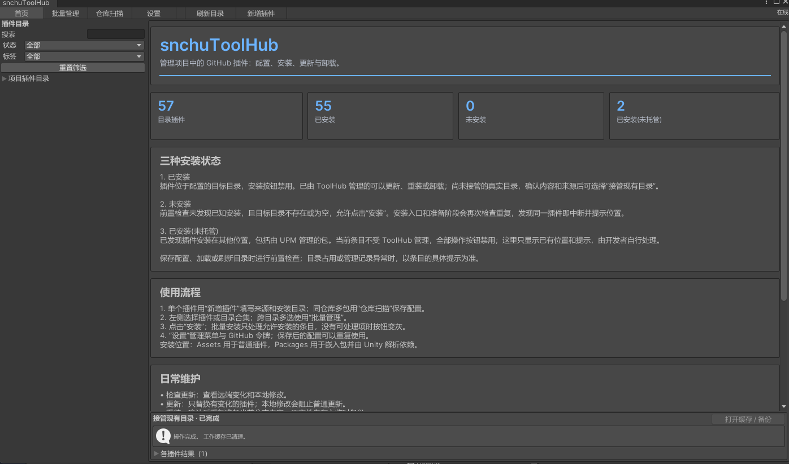

# snchuToolHub

snchuToolHub 是 Unity 编辑器中的 GitHub 插件管理工具。为插件配置来源和安装目录后，可以通过同一套界面完成安装、更新、重装、卸载及批量管理。

支持将普通插件复制到 `Assets`，将标准 UPM 包复制到 `Packages` 作为嵌入包。界面使用 IMGUI，工具仅在编辑器中运行。



## 1、设计理念

- **配置一次，持续复用。** 每个插件独立保存仓库、分支、来源目录、安装目录和依赖；菜单只负责分类，不提供隐含的默认仓库。
- **适应插件自身的结构。** 同一个 GitHub 仓库可以包含多个插件，不要求作者把所有内容拆成独立仓库。
- **同仓库共享获取。** 同一批操作按仓库与分支分组获取，各插件使用同一个提交，再按目录分别安装，减少重复下载。
- **管理权明确。** ToolHub 维护自己安装或主动接管的目录。项目其他位置的插件只检测和告知，由开发者自行处理。
- **维护过程可预期。** 普通更新遇到本地修改时停止；重装需要确认；文件提交失败先回滚。配置编辑与文件安装分开。
- **只管理一份配置。** 开发者只维护 `Config~/menu.json`，插件来源、目录和自动维护的更新基线都在这份文件中。长期内容只有这份配置和实际安装的插件文件。
- **缓存只服务当前任务。** 下载、暂存和任务恢复数据临时保存在 `Cache~`，任务结束后自动清理，不保存独立设置、安装记录文件、任务历史或源码备份。

## 2、环境、前置配置与安装

使用 Unity 2022.3 LTS 或兼容版本，系统需安装可通过 `PATH` 调用的 Git。推荐以下两种安装方式，选择一种即可。

### 2.1 提前配置 GitHub 令牌

**强烈建议在首次安装插件前完成令牌配置。** 有权限的令牌可用于 HTTPS 私有仓库访问及 GitHub API 身份验证。公开仓库的 Git 下载允许匿名使用；令牌不会提高网络带宽，也不能解决代理等网络问题。

1. 在 [GitHub 令牌设置](https://github.com/settings/tokens) 创建自己的 Personal Access Token。优先使用细粒度令牌，访问私有仓库时只授予所需仓库的读取权限。
2. 在 Windows 本机、**Unity 项目和 snchuToolHub 文件夹之外**创建 txt，例如 `%USERPROFILE%\.snchu\github-token.txt`；文件仅包含一行令牌。
3. 打开工具的 **设置 → 选择本地 txt**，选择该文件，再使用“检测 GitHub 连接”检查凭据和网络。
4. 读取一次后，当前 Unity 会话会复用；关闭工具窗口或编译脚本无需重新选文件。令牌内容不会写入工具、项目配置或缓存。

需要重启 Unity 后也免选文件时，在 Windows **用户环境变量**中设置 `SNCHU_TOOLHUB_TOKEN_FILE`，值填写上述 txt 的绝对路径，**不是令牌内容**。工具会读取该路径；也可在设置中点击“读取环境变量指定的文件”。详细规则见 [6.4 GitHub 令牌](#64-github-令牌)。

### 2.2 Assets 安装

1. 提前通过 Unity Package Manager 安装 Editor Coroutines（`com.unity.editorcoroutines`）和 Newtonsoft JSON（`com.unity.nuget.newtonsoft-json`）。
2. 将工具文件夹复制到 `Assets/ThirdParty/snchuToolHub`，等待 Unity 编译完成。

### 2.3 Packages 安装

1. 将工具文件夹复制到 `Packages/com.snchu.toolhub`，确保 `package.json` 位于该目录根部。
2. Unity 会自动安装依赖，等待解析和编译完成即可。

复制时保留随源码提供的 `.meta` 文件。安装完成后，打开 **SnchuTools → snchuToolHub**。

## 3、基本使用

### 3.1 页面与目录

顶部页面为 **首页 / 批量管理 / 仓库扫描 / 设置**。左侧仅显示项目插件目录，可按名称、状态和标签筛选；子目录合集默认收起。

首页在标题下首先显示“使用流程”，第一步为“添加令牌”；随后显示统计、三种安装状态、日常维护和制作理念。

首次使用直接点击“新增插件”，保存时自动创建 `Config~/menu.json`。设置页可打开这份配置或导入 JSON；导入会替换当前配置，已安装文件保留。

### 3.2 添加单个插件

1. 点击“新增插件”，填写名称、菜单位置、GitHub 仓库所有者、仓库名、分支、仓库内目录和项目内安装目录。
2. 仓库网址可通过“识别仓库”填入所有者及仓库名；“配置示例”可填入通用模板，请替换占位信息。
3. 点击“保存配置”，将条目加入目录。
4. 选择该插件，查看安装状态，再执行安装。

保存配置只保存条目，不下载或安装插件。

### 3.3 同仓库多个包

1. 进入“仓库扫描”，填写仓库来源及扫描目录；扫描目录留空表示整个仓库。
2. 安装根目录可选择 `Packages` 或 `Assets` 下的插件目录，例如 `Assets/ThirdParty`。
3. 点击“扫描包清单”，查看包名、版本、来源目录和目标目录。
4. 勾选有效条目，点击“保存选中配置”。
5. 选择左侧目录合集进行整组操作，或在“批量管理”中跨目录多选。

扫描读取 `package.json`，不直接安装包。无效清单单独报错，同名包存在多个来源目录时应选择正确的一项。保存前会检查重复菜单位置和安装目录。

## 4、安装状态与操作规则

### 4.1 只有三种状态

| 状态 | 含义 | 处理方式 |
| --- | --- | --- |
| **已安装** | 插件位于配置的目标目录 | 禁止重复安装；已托管的可维护，尚未接管的真实目录可确认后主动接管 |
| **未安装** | 前置检查未发现已知安装，目标不存在或为空 | 允许安装；安装入口和准备阶段继续检查重复 |
| **已安装(未托管)** | 已发现插件安装在其他位置，包括由 UPM 管理的包 | 当前条目所有操作禁用；显示已有位置和提示，由开发者自行处理 |

新增配置不会自动取得已有文件的管理权。接管只登记配置目标中的真实目录与本地文件基线，不搬移文件，也不证明文件来自某个远端提交。

保存、加载和刷新目录时进行前置检查。前置判断使用已注册包和现有管理记录；无法由这些信息识别的手工副本，会在安装准备阶段按包名、程序集、资源 GUID 和必要的脚本指纹继续检测。发现冲突时整批停止并提示具体位置。

状态以实际文件和 UPM 注册结果为准。目标目录不存在或为空时显示“未安装”，历史安装信息不会产生“文件缺失”等额外状态。路径被同名文件占用、配置无效等问题只通过错误提示阻止操作。

状态筛选提供“全部 / 已安装 / 未安装 / 已安装(未托管)”，三种状态分别筛选，首页计数与详情共用同一判断。

### 4.2 维护操作

| 操作 | 行为 |
| --- | --- |
| 安装 | 先获取包清单并检查整批依赖，通过后下载主体、校验重复并提交目标文件 |
| 检查更新 | 比较远端目录版本和本地文件，不修改插件目录 |
| 更新 | 只处理来源目录有变化的插件；发现本地修改时停止覆盖 |
| 重装 | 确认后重新准备当前分支内容，并覆盖所选目录 |
| 卸载 | 检查包依赖，移除托管目录并核对包解析结果 |
| 接管现有目录 | 登记指定目录的现有文件及来源配置，不下载或改动文件 |

单个插件、目录合集和跨目录批量使用相同的状态与权限规则。批量页面会排除不具备操作条件的条目。

“删除配置”只删除菜单条目，不卸载插件。修改安装路径或来源会清除该条目的管理信息，不会迁移旧文件；已有目标目录需确认后重新接管。

## 5、配置格式

完整模板见 [Examples~/menu.example.json](Examples~/menu.example.json)。菜单保存名称、版本、拥有者、简介和 `Plugins` 数组，每个插件使用同一组字段：

| 字段 | 说明 |
| --- | --- |
| `Name` | 插件名称 |
| `Version` | 展示用版本说明，更新判断使用实际 Git 版本 |
| `Author` | 插件作者 |
| `Intro` | 插件简介 |
| `MenuPath` | 左侧目录位置，使用 `/` 分类 |
| `Tags` | 标签数组 |
| `LocalPath` | 项目内安装目录，如 `Assets/ThirdParty/MyPlugin` 或 `Packages/com.example.plugin` |
| `GitURL_Username` | GitHub 仓库所有者，必填 |
| `GitURL_RepoName` | 仓库名称，必填 |
| `GitURL_Branch` | 分支或标签，必填 |
| `GitURL_Path` | 相对仓库根目录的来源目录，留空表示根目录 |
| `IntroductionURL` | 说明链接 |
| `Dependencies` | 外部 UPM 依赖数组 |
| `Installation` | 安装或接管后自动保存的来源提交、文件清单和校验基线；无需手写，不决定是否实际安装 |

项目内路径相对于 Unity 项目根目录，即 `Assets` 与 `Packages` 的上一级，不依赖进程工作目录或 ToolHub 所在位置。可选文本使用空字符串，可选列表使用空数组。

外部依赖格式：

```json
[
  { "name": "com.example.dependency", "version": "1.0.0" }
]
```

`version` 也可填写 UPM 支持的 Git URL 等来源。旧菜单中的默认 Git 字段会在输入时展开到独立条目，当前配置不使用菜单级默认仓库。

## 6、依赖、任务与缓存

### 6.1 依赖解析

安装到 `Packages` 的来源目录必须包含有效的根 `package.json`，目标必须是 `Packages` 的直接子目录。复制完成后由 Unity 识别为嵌入包，本体不另行写入项目 `manifest.json` 的 `file:` 引用。

同批安装的本地包可以互相满足依赖。已注册包、Unity Registry 包和项目已有 scoped registry 由 UPM 解析。需要指定第三方依赖来源时，将它作为插件一并安装，或填入 `Dependencies`；ToolHub 不猜测第三方 Git URL。

安装、更新和重装先通过 GitHub API 读取所选插件根目录的 `package.json`，检查整批声明的依赖和显式 `Dependencies`；通过后才启动 Git 克隆和文件下载。预检清单仅保留在当前任务内存中，不创建仓库缓存。同仓库先确定一个提交，以最多 4 个并发请求读取清单；主体下载使用同一个提交，仍然共享一次克隆。普通 `Assets` 插件可以没有包清单，但显式依赖仍参与检查。

缺少依赖来源时，整批停止，一次列出所有缺失包名、要求版本和引用插件；Git 尚未启动，目标目录与 `menu.json` 不提交，临时缓存自动清理。将对应插件选入本批安装、在 `Dependencies` 中填写 Git URL / 本地来源，或先通过 Package Manager 安装后再试。只有版本号、没有对应 registry 的第三方依赖仍算缺少来源；项目 manifest 中已有的 Git / 本地来源可以复用。

预检也需要联网读取清单：API 请求每次最多等待 30 秒，连接中断、超时或服务器临时错误最多重试 2 次。获取清单失败时显示“依赖预检未完成”，不启动 Git、不假定依赖齐全。预检通过后若 Git 获取失败，另行提示下载阶段失败；API 检测成功不能保证 Git 下载可用。

预检判断的是声明的包依赖及下载来源；有来源的依赖不要求提前安装，交给后续 UPM 解析。网络可达性、版本解析和包清单未声明的 NuGet / DLL 依赖仍需在对应安装流程中处理，不能仅凭 `package.json` 自动推断。

外部依赖统一合并，来源冲突时中断，避免逐插件重复提交 UPM 请求。

### 6.2 提交与恢复

Git 获取、校验和文件准备在后台执行；Unity API 与文件提交在编辑器主线程处理。一次批量操作使用同一来源提交，更新依据远端提交、目录版本和本地文件基线判断。

同仓库选中的文件统一下载后再检出，避免连带下载未选目录。下载阶段显示 Git 进度和当前步骤的等待时间；HTTP 传输连续 120 秒几乎无数据时中止，单次 Git 命令超过 10 分钟也会终止并提示检查网络与代理配置。失败后按任务清理规则移除缓存，可重新安装。

准备阶段允许取消，正式提交和 UPM 原生请求不提供中途取消。文件提交失败先回滚；编辑器重启时恢复未完成提交。恢复未完成会报错并阻止新任务。

文件已提交但 UPM 解析失败时，保留已安装文件并清理缓存。当前会话可修正依赖后点击“重试包解析”，无需重新下载；重新打开 Unity 后通过 Package Manager 处理依赖。任务结果仅保留在当前会话，关闭工具窗口不会终止任务。

### 6.3 临时文件清理

- 成功、下载或校验失败、取消后，清理下载副本和暂存。
- 文件提交失败先完成回滚，再清理；提交成功后立即清理下载和暂存，包解析结束后清理临时任务文件。
- 清理覆盖整个工作缓存，包括历史任务残留。意外退出的残留在下次启动处理。
- 只有回滚未完成时暂留当前恢复目录，防止删除唯一的旧文件副本；恢复完成后清理。
- 清理失败明确提示并在后续启动或任务结束时重试，不覆盖原任务结果。

下次操作重新获取远端，同一批多个包仍共享一次获取。更新判断和 UPM 重试不依赖下载缓存，不保留历史版本备份。

### 6.4 GitHub 令牌

令牌配置是推荐的前置步骤，操作见 [2.1](#21-提前配置-github-令牌)。GitHub REST API 通常对匿名请求限额为每小时 60 次，使用个人访问令牌认证后为每小时 5,000 次；这些是 API 请求限额，与 Git 仓库下载速度不同。[GitHub 官方说明](https://docs.github.com/en/rest/using-the-rest-api/rate-limits-for-the-rest-api)

- 只从项目和工具目录之外的本机 txt 读取，不提供直接输入令牌，也不复制源文件。
- 令牌内容只在内存中缓存，不参与 Unity 序列化；不写入 `menu.json`、设置文件、工作缓存、仓库 URL 或任务结果。
- 会话内记住文件位置，脚本重载后按原路径重新读取，关闭窗口无需重复选择。“重新读取”用于更新令牌后的重新加载；“清除本次读取”不会删除源 txt。
- 关闭 Unity 后，会话内存清除。可通过 Windows 用户环境变量 `SNCHU_TOOLHUB_TOKEN_FILE` 自动读取外部 txt；工具只读取这个变量，不创建或修改它，也不保存路径到工具文件夹。
- 配置了文件但读取失败、文件为空或格式错误时，明确报错并中断当前请求，不静默改用匿名访问。
- 上传工具到 GitHub 时，外部 txt 不在发布目录中。不要将令牌填写到配置、代码或仓库地址里；旧版工具内部的令牌副本在迁移时清理。

设置中的“检测 GitHub API”验证 API 的连接与认证。插件下载由本机 Git 执行，使用 Git 自身的网络与代理配置；API 检测成功不代表 Git 下载一定可用，也不代表每个私有仓库都有访问权限。

Git 已设置的代理优先；没有代理环境变量时，ToolHub 将系统代理传给当前 Git 子进程，避免 Unity 能访问 GitHub、Git 却直接连接失败。工具不写入全局 Git 配置或代理设置，系统代理的绕过规则及 `NO_PROXY` 仍然有效。

ToolHub 为每个 Git 调用指定完整仓库地址的进程级 HTTPS 规则，避免常见的全局 `https://github.com/` → `git@github.com:` 改写导致下载走 SSH、令牌无法参与认证。工具不修改本机全局 Git / SSH 设置，令牌仍仅通过本次进程环境传递。若更具体的 URL 改写仍造成冲突，在克隆前明确报错。令牌权限、有效期和组织授权按 [GitHub 官方指引](https://docs.github.com/en/authentication/keeping-your-account-and-data-secure/managing-your-personal-access-tokens) 配置，仅申请所需读取权限。

上述规则作用于 ToolHub 自行执行的 Git 下载。由 Unity 原生 UPM 获取的外部 Git 依赖仍使用 Unity / 本机 Git 配置。

## 7、目录与发布内容

发布目录：

```text
snchuToolHub/
├─ Editor/                   编辑器代码及程序集定义
├─ Documentation~/
│  └─ snchutoolhub-demo.png   README 演示图
├─ Examples~/
│  └─ menu.example.json      通用配置示例
├─ package.json              包信息及依赖
├─ README.md
├─ LICENSE
├─ .gitignore
└─ .npmignore
```

保留随源码提供的 `.meta`。`Examples~` 不作为游戏资源导入，示例不会自动安装。

项目使用数据：

| 位置 | 内容 |
| --- | --- |
| `Config~/menu.json` | 唯一长期配置：插件条目和自动维护的更新基线 |
| 配置的 `Assets/...` 或 `Packages/...` | 真正安装的插件文件 |
| `Cache~` | 仅在当前任务中使用的下载、暂存、恢复数据，结束后清理 |

上传独立工具仓库时，只提交发布目录中的文件，不携带当前项目的 `Config~`、`Cache~` 或历史备份。Git 和打包忽略规则已覆盖这些本地数据；忽略规则不会自动移除已经被 Git 跟踪的文件，已有跟踪项需在发布仓库中取消跟踪。

后续修改功能、配置结构或安装规则时，同步更新本 README。

## 8、许可证

采用 MIT 许可证，版权及授权声明见 [LICENSE](LICENSE)。
